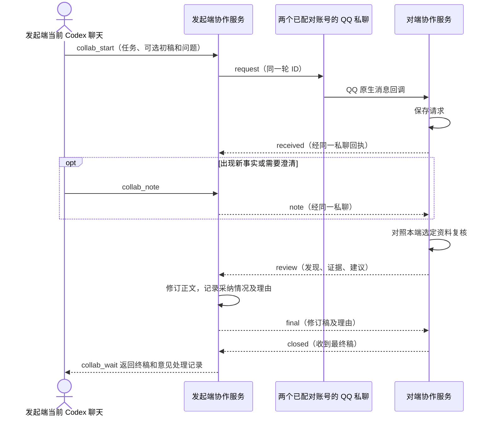

# 两台设备通过 QQ 私聊完成同一轮工作

在已有 Codex 聊天中，可以请另一台设备检查一个会影响结论的问题。例如，发起端只掌握 Windows 的验收数据，可以把初稿和发布门槛交给 Mac。Mac 立即回执，随后回传具体发现、可引用的证据和修改建议。发起端修订同一份稿件，向 Mac 回传最终版本。Mac 收到最终版本后确认结案。两端都可以发起。

## 一轮工作如何推进

**什么时候值得叫另一端参与？** 有一项只能由对端验证的事实、一个可被证据推翻的初步判断，或明确的审稿标准时，双方能减少同一个结果里的错误。普通配对私聊也可以只传文字。未按协作协议寻址的消息不会启动执行器。

## 即时性和恢复

| 环节 | 实现和观察方式 |
|---|---|
| 接收 | QQ 原生回调校验登录账号、好友 UID、私聊会话及协议地址后落盘，立即唤醒本机正在等待的服务。长等候的超时只用于重新建立等待，有消息时会提前返回。Windows 和 Mac 各自另行补读历史。 |
| 对端已收到 | `received` 在登记后立即排入发送，与模型生成并行。原生 API 的 `accepted` 表示本机已提交；在发起端观察到 `received` 才有对端登记证据。 |
| 中途补充 | 双方各可发送两条 `note`。服务处理新备注时会唤醒等待中的聊天。若复核或修订生成期间收到了新备注，会按最新备注重新生成；一轮最多四条备注。 |
| 断线和重启 | 收件游标、工作阶段与发件记录保存在本机 SQLite。服务按原请求号重试传输，未知原生发送结果保留待核对。对端按协议事件 ID 去重。重新启动时重新计算中断的只读生成步骤，已登记的终稿不会重新开始一轮。 |
| 结案 | 终稿带版次和已纳入的备注编号。若对端已经发出的一条更正仍在途中，对端会退回补充，发起端纳入后再出新稿。确认回执必须指向最新终稿的事件 ID，`awaiting_close` 才转为 `complete`。模型失败记录为 `failed`，24 小时后仍未完成的轮次到期。 |
| 可见性 | `collab_wait` 可等待结案，也可用 `after` 等待下一条事件。发起端可使用本地入队和接收时间计算往返耗时，无需两台机器时钟完全一致。协议允许五分钟时钟偏差。 |

这里采用事件通知和可追踪回执分别表示“有新信息”和“对端已处理”。初稿、同行复核、修订对应有明确评价标准的审稿循环。接入保留了现有 QQ 和本机 SQLite 实现。[Temporal 消息交互](https://docs.temporal.io/encyclopedia/workflow-message-passing) · [Anthropic 的 evaluator–optimizer 模式](https://www.anthropic.com/research/building-effective-agents)

## 如何使用

两台设备各用一个已登录的 QQ 协作账号，互为可解析的好友。每端在本机明确指定另一账号，使用独立状态目录；运行协作服务需要支持 `node:sqlite` 的 Node 22.13+ 和已登录的 Codex CLI。可选的资料文件为本地明确选用、允许在这轮交流中引用的 UTF-8 节选，限 8 KiB。资料仅在本机运算，对端可能收到其中被引用的内容。Mac 和 Windows 的安装说明包含账号设置、服务启动及 MCP 注册方式。[Mac 安装](../macos/README.md) · [Windows 安装](../windows/README.md)

在已加载协作 MCP 的聊天里，可以说：

> 请让另一台设备复核这份初稿。特别检查它本机的验收记录，在它回复后给我修订稿，并说明哪一条证据改变了判断。

- `collab_start` 传 `task`。有现成草稿时同时传 `draft` 和 `question`；仅传任务时，本机先生成初稿和要查证的问题。同一操作重试沿用 `request_id`。
- 普通私聊用 `peer_read_latest` 读取配对会话最新消息，用 `peer_send_text` 发送用户指定的文字。普通私聊不会创建协作任务。
- `collab_note` 传轮次 `id`、新的 `request_id` 和 `text`，把补充送给同一轮的对端。
- `collab_wait` 传 `id`，可选 `after` 和 `timeout_ms`。一次等待超时会返回当前快照，可继续等待同一轮。
- `collab_status` 可以列出本机最近轮次，或用 `id` 读取初稿、证据、备注、终稿与时间线。处理决定为采纳、部分采纳、保留原结论或拒绝建议，并附理由。
- 在另一台机器已打开的聊天中，可用 `collab_listen` 等对端发来新请求或补充，直接取得轮次编号。后续用返回的 `cursor` 接着听，即使换聊天或重连也可以补读。只想跟进某一轮时用 `collab_wait`。

## 验收协作效果

**离线完整链路**。从仓库根目录运行 `node --test collaboration/integration.test.cjs`。测试用两个独立服务进程、两份本地数据库、正式平台适配器及 stdio MCP，模拟 QQ 和模型响应。检查两个发起方向、断线补收、重复投递、工作中补充以及两端终稿一致。另以多轮合成消息记录收到回执的中位数和第 95 百分位，和模型耗时分开。

**已实测的范围**。在 Windows 本机的 20 轮热服务采样中，从模拟原生消息到达对端到发起端的 MCP 看到回执，一次采样的中位数约 27 ms、第 95 百分位约 34 ms。另一次显式启用真实 Codex 的同机验收中，从入队至看到对端回执为 39 ms，至获得审阅为 5.831 秒，至双方确认终稿为 12.611 秒。初稿只掌握 80 ms 并判断 GO；对端引用独有的 240 ms 资料后，两端得到相同的 HOLD 终稿。QQ 传输在上述两项检查中均为合成。设置 `QQ_COLLAB_REAL_MODEL=1` 后可执行 `node --test --test-name-pattern="opt-in" collaboration/integration.test.cjs` 重跑真实模型场景，将使用本机 Codex 配额。

**真实双机**。下面这轮使用合成验收数据。发起端已有 Windows 80 ms 的草稿，门槛为两台设备均不超过 150 ms。只在审阅端的服务配置中选用 `collaboration/fixtures/live-evidence.txt`。该文件提供对端 240 ms 这项草稿中缺失的证据。Mac 的自动安装读取 `./macos/bridge collab paths` 显示的协作目录里的 `collaboration-evidence.txt`；如已有自己的资料，请使用独立测试 profile 或单独启动服务。

1. Mac 从解压后的仓库目录运行 `./macos/bridge collab pair <Windows协作QQ号> [Mac协作QQ号]`。已有本机绑定时可省略第二个号码。命令保留其他联系人。准备好本次允许引用的资料后运行 `./macos/bridge install`。
2. 两端各自查询本地 `health`。Mac 可用 `./macos/bridge collab health`。此处的 `ready` 验证的是本机与 QQ 的连接；跨机往返由下一步验证。
3. 发起端运行 `node collaboration/verify-live.cjs run <本端状态目录>`。它先显示本轮 UUID，再向配对账号提交这次测试，最多等待三分钟。审阅端会通过私聊回传自己保存的终稿散列、版次、事件编号及运行平台。
4. `pass: true` 要求一端为 Windows、另一端为 macOS，240 ms 证据使初稿 GO 改为 HOLD，双方核对的终稿一致，且发起端实际收到各阶段回执。用 `ownerQueueToPeerAckMs` 读真实往返耗时。若等待超时，稍后在发起端运行 `node collaboration/verify-live.cjs check <本端状态目录> <原UUID>`，可继续查同一轮。

旧端仅回传终稿事件 ID 时，可在两端分别运行 `node collaboration/verify-live.cjs inspect <本端状态目录> <UUID>`，保存 UTF-8 的 `owner.json` 和 `reviewer.json`，再执行 `node collaboration/verify-live.cjs compare owner.json reviewer.json` 做独立核对。两个验收方向可以交换发起端重测。

不同任务能否改善质量需要实际验收。这个例子验证“另一端的独有证据是否改变交付物”，真实网络耗时由上述双机回执测得。
